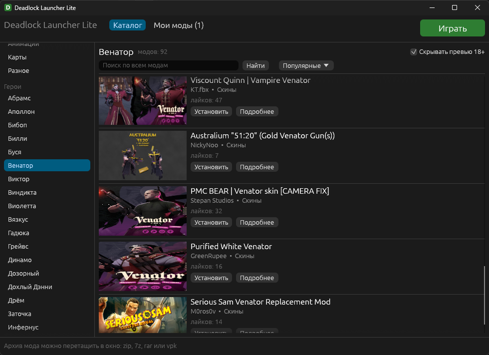
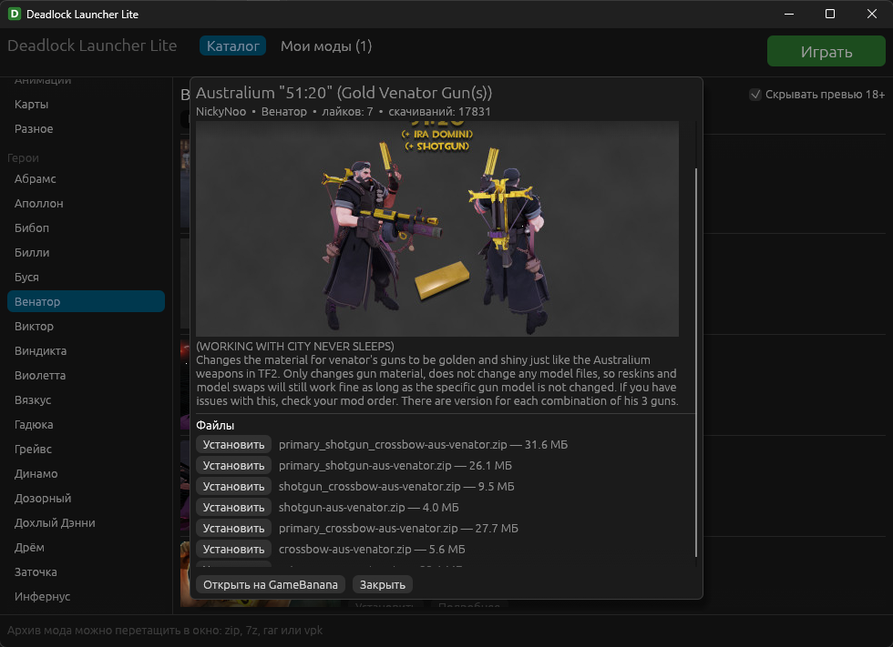
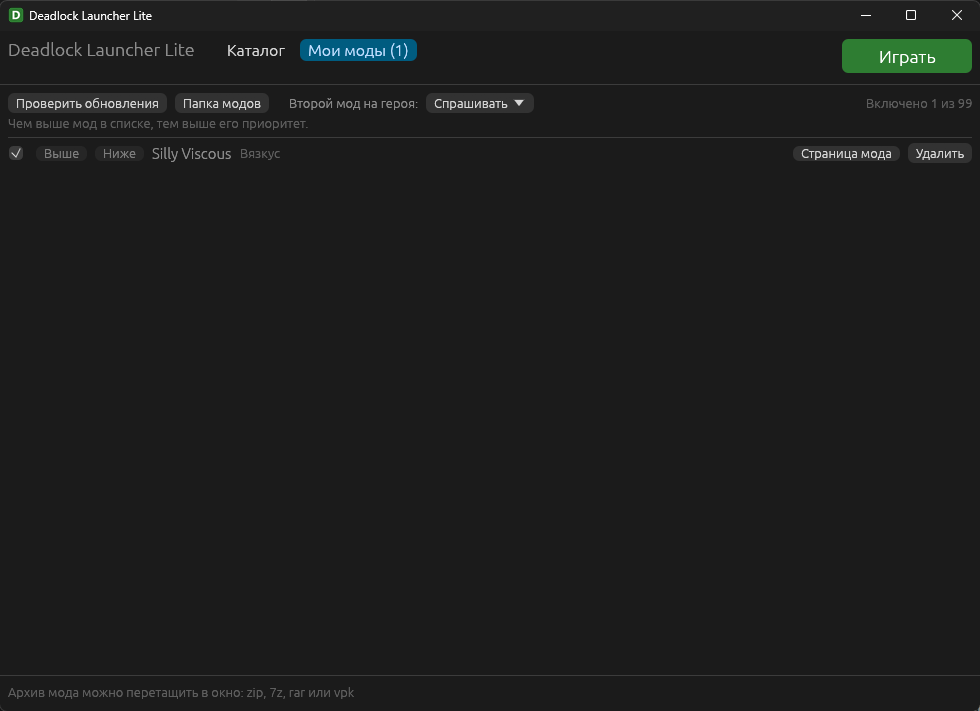

# Deadlock Launcher Lite

Лёгкий менеджер модов для Deadlock: каталог GameBanana с разделами и героями, установка в один клик и запуск игры. Один exe-файл, ничего не нужно устанавливать.



## Возможности

- **Каталог GameBanana.** Разделы (интерфейс, удобство и фиксы, геймплей, модели, анимации, карты, разное) и все герои. Имена героев берутся из официальной русской локализации игры, поэтому совпадают с тем, что вы видите в Deadlock. Новые герои появляются сами.
- **Установка в один клик.** Мод скачивается прямо в папку игры, без браузера. Поддерживаются zip, 7z, rar и отдельные файлы vpk.
- **Перетаскивание.** Скачанный архив можно перетащить в окно лаунчера.
- **Второй мод на героя.** Лаунчер спросит, заменить старый мод или оставить оба. Выбор можно запомнить.
- **Управление модами.** Включение и выключение, порядок загрузки, удаление, проверка обновлений.
- **Кнопка «Играть».** Проверяет, что игра увидит моды, и запускает Deadlock через Steam.
- **Скрытие превью 18+.** Включено по умолчанию.





## Почему Lite

- **Без встроенного браузера.** Интерфейс рисуется напрямую, без Chromium и WebView2. Нет фоновых служб, автообновления, телеметрии и аккаунтов.
- **Не нагружает процессор в простое.** Окно перерисовывается только когда что-то меняется. Свёрнутое окно не рисуется вовсе.
- **Мало памяти.** Около 80–90 МБ, и большую часть из них занимает драйвер видеокарты.
- **Минимум записи на диск.** Каталог не копируется на компьютер: списки и картинки загружаются по мере просмотра и выгружаются при смене страницы. На диск пишутся только сами моды и небольшой файл настроек.
- **Один файл.** exe около 8 МБ, библиотеки Visual C++ уже встроены.

## Установка

1. Скачайте zip со страницы [Releases](../../releases).
2. Распакуйте в любую папку и запустите `deadlock-launcher-lite.exe`.
3. Лаунчер сам найдёт Deadlock в библиотеках Steam. Если не найдёт, укажите папку игры, например `X:\SteamLibrary\steamapps\common\Deadlock`.

### «Система Windows защитила ваш компьютер»

У программы пока нет цифровой подписи, поэтому при первом запуске Windows показывает синее окно. Нажмите «Подробнее», затем «Выполнить в любом случае». В планах получить бесплатную подпись через [SignPath Foundation](https://signpath.org/), которая подписывает проекты с открытым кодом. После этого окно пропадёт.

### Антивирус ругается на файл

Новые неподписанные программы, которые скачивают файлы и меняют файлы игры, иногда ловят ложное срабатывание антивируса. Исходный код открыт: его можно проверить или собрать exe самостоятельно (см. «Сборка из исходников»).

### Как поделиться с друзьями

Отправьте ссылку на страницу Releases или сам zip-архив. Дополнительно ничего ставить не нужно.

## Как это работает

- Моды лежат в `game\citadel\addons` под именами `pak01_dir.vpk`, `pak02_dir.vpk` и так далее. Чем меньше номер, тем выше приоритет: если два мода меняют одно и то же, побеждает тот, что выше в списке.
- Выключенные моды переносятся в `game\citadel\addons_disabled`. Включение и выключение — это переименование файла, без копирования.
- Чтобы игра загружала папку `addons`, в `game\citadel\gameinfo.gi` добавляются три строки между метками `// deadlock-launcher start` и `// deadlock-launcher end`. Перед изменением исходный файл сохраняется в `gameinfo.gi.backup`.
- Обновление игры перезаписывает `gameinfo.gi`. Лаунчер возвращает строки при каждом запуске и по кнопке «Играть». Если после обновления вы запускаете игру прямо из Steam, сначала откройте лаунчер.
- Игра загружает не больше 99 модов из папки `addons`.
- Список модов и настройки хранятся в `%APPDATA%\deadlock-launcher\state.json`.

## Частые вопросы

**Мод не появился в игре.** Запустите игру кнопкой «Играть» и проверьте, что мод включён в «Моих модах». Некоторым модам нужна особая установка: прочитайте описание мода на GameBanana.

**Автор мода пишет, что он несовместим с менеджерами модов.** Такие моды ставятся вручную по инструкции автора.

**Как вернуть всё как было.** Удалите моды в «Моих модах». Затем замените `gameinfo.gi` файлом `gameinfo.gi.backup` или проверьте целостность файлов игры в Steam.

**Можно ли пользоваться вместе с Deadlock Mod Manager.** Лучше выбрать что-то одно: обе программы управляют папкой `addons`. Чужие файлы в `addons` лаунчер покажет в списке как «установлен вручную».

## Сборка из исходников

Нужны Rust (stable, MSVC) и Windows SDK, из которого берётся иконка exe.

```bash
cargo build --release
```

Готовый файл: `target\release\deadlock-launcher-lite.exe`.

Тесты: `cargo test`. Тесты с настоящими запросами к GameBanana: `cargo test -- --ignored`.

## Благодарности

- [Deadlock Mod Manager](https://github.com/deadlock-mod-manager/deadlock-mod-manager): идея и подход к установке модов. Lite не использует его код, это отдельная программа, написанная с нуля на Rust.
- [GameBanana](https://gamebanana.com/games/20948): каталог модов и открытый API.
- Авторам модов, без которых всего этого не было бы.

## Отказ от ответственности

Проект не связан с Valve, GameBanana и Deadlock Mod Manager. Deadlock — товарный знак Valve Corporation. Моды создаются сторонними авторами; устанавливайте их на свой риск.

## Лицензия

[MIT](LICENSE).
